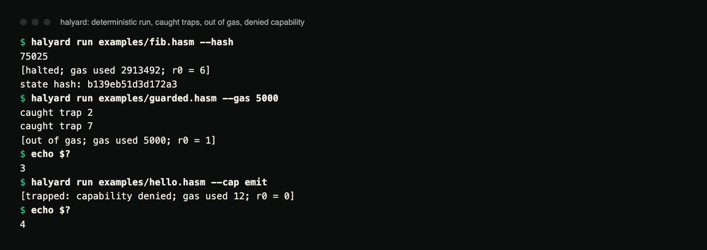
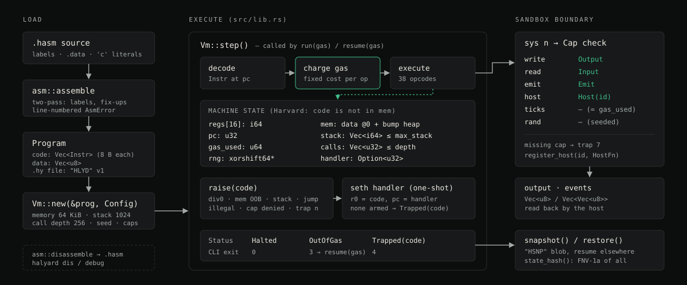
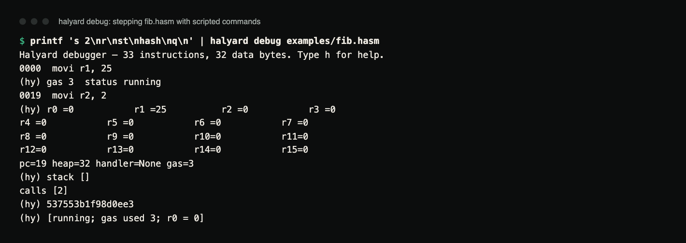

# Halyard

A deterministic, gas-metered, capability-gated register VM for running small
untrusted programs and replaying exactly what they did.

[](https://github.com/hellpuffyt/halyard-vm/actions/workflows/ci.yml)
[](LICENSE)

[Case study ↗](https://hellpuff.dev/work/halyard-vm)

Halyard is a small register VM (16 × i64 registers, fixed 8-byte
instructions) for automation steps such as agent tools, workflow actions or
plugins, where the host has to bound how long the code runs, control what it
can touch, and be able to show what happened afterwards. It is pure Rust with
no dependencies: about 1,460 lines across the VM, the assembler and the CLI
with its debugger.

```
$ halyard run examples/fib.hasm --hash
75025
[halted; gas used 2913492; r0 = 6]
state hash: b139eb51d3d172a3

$ halyard run examples/guarded.hasm --gas 5000
caught trap 2
caught trap 7
[out of gas; gas used 5000; r0 = 1]
$ echo $?
3
```



*Terminal capture of the two runs above plus `hello.hasm` started without the
`output` capability (real output, rendered from the saved transcript).*

`fib.hasm` prints `fib(25)` and the same state hash on every run; CI checks
that hash on Linux, macOS and Windows. `guarded.hasm` catches an
out-of-bounds read (trap 2) and a syscall it has no capability for (trap 7)
in its own handler, then spins in an infinite loop until the gas meter stops
it. Exit code 3 means out of gas. `hello.hasm` run with `--cap emit` has no
`output` capability, so its first `sys write` traps with no handler armed and
the VM stops with exit code 4.

## Properties

| Property | How |
|---|---|
| **Deterministic** | No wall clock, no OS randomness, no threads. `sys ticks` returns the gas counter; `sys rand` is a seeded xorshift. `Vm::state_hash()` fingerprints the whole machine, so equal inputs give equal hashes. |
| **Metered** | Every instruction has a fixed gas cost. `run(gas)` stops with `OutOfGas` and can be `resume`d, which gives preemption without threads. |
| **Capability-gated** | The only ways out of the sandbox are numbered syscalls, each behind an explicit `Cap` (`Output`, `Input`, `Emit`, `Host(id)`). A missing capability is a trap, not a silent no-op. |
| **Resumable** | `snapshot()` / `restore()` serialise registers, memory, stacks, heap, handler, gas and RNG. A step can be paused, persisted, resumed on another machine and end in the same state. Host functions are not part of a snapshot and must be registered again after `restore`. |
| **Trap model** | Division by zero, out-of-bounds memory, stack overflow, bad jumps, illegal instructions, denied capabilities and user `trap n` deliver a code to an in-program handler (`seth`) or halt the VM with `Trapped(code)`. |
| **Harvard layout** | Code lives outside data memory. No self-modifying code, no jumping into data. |

Tooling: an assembler with labels, data directives and character literals; a
disassembler whose output re-assembles to identical code; an interactive
debugger (step, continue, breakpoints, registers, memory dump, stacks, state
hash); and an execution trace.

## Why a new VM

WebAssembly is the right answer for portable, fast sandboxing. It is also a
large specification with JIT engines you cannot read in an afternoon, no
built-in gas metering and no serialisable machine state. Lua and similar
languages embed well but are not deterministic by default and cannot be
paused and resumed byte-for-byte. Halyard gives up speed and expressiveness
for four properties an orchestrator needs: bounded, deterministic,
inspectable and resumable.

Design choices that follow from that:

- **Gas is part of the ISA.** Costs are documented per instruction in
  [`docs/ISA.md`](docs/ISA.md), and `sys ticks` exposes the meter to the
  program itself.
- **Capabilities are per syscall and per host-function id.** A program with
  `Host(7)` cannot call host function 8. The host registers closures; the VM
  passes them a mutable view of guest memory and three arguments.
- **A snapshot is the unit of scheduling.** A `Vm` that ran out of gas is a
  complete, serialisable value.
- **Traps are recoverable in-program** through a one-shot handler, so a step
  can clean up and report instead of dying.
- **Fixed-width instructions** keep the decoder trivial, the disassembler
  exact and the trace cheap.

What the tests pin down: every trap code; gas accounting to the unit;
capabilities from both sides (denied and granted, registered and
unregistered); snapshots resuming to the same `state_hash` as an
uninterrupted run; and corrupt program and snapshot files being rejected
without a panic. See [`TESTING.md`](TESTING.md).

## Architecture



*Diagram of the load path, the `Vm::step` loop, machine state, the trap path
and the syscall/capability boundary, drawn from `src/lib.rs` and `src/asm.rs`.
[`ARCHITECTURE.md`](ARCHITECTURE.md) has the details and file formats.*

## Build and test

Requires Rust 1.88 or newer (`rust-version` in `Cargo.toml`, edition 2024).

```
cargo build --release              # target/release/halyard
cargo test                         # 35 tests + 1 doc test
cargo run --release --example embed
cargo run --release --example bench
```

`cargo test` runs the ISA, sandbox, determinism, allocation-bounds,
assembler and CLI suites. The `embed` example registers a host function and
shows the same call denied without `Cap::Host(1)`:

```
$ cargo run --release --example embed
plugin returned 6749 (gas used 54)
without Cap::Host(1): trapped: capability denied
state hash: 17ed7a7a659f6bd4
```

## CLI

```
halyard asm   examples/fib.hasm -o fib.hy       # assemble to a .hy program file
halyard dis   fib.hy                            # disassemble
halyard run   fib.hy --gas 5000000 --hash
halyard run   examples/hello.hasm --trace       # executed pcs go to stderr
halyard run   examples/checksum.hasm --input README.md --cap input,emit,output
halyard debug examples/fib.hasm                 # s [n], c, r, m A N, b PC, d, st, hash, h, q
```

`run` and `debug` accept a `.hasm` source file directly or an assembled `.hy`
file. Options for `run`:

| Option | Default | Meaning |
|---|---|---|
| `--gas N` | 10,000,000 | gas budget for the run |
| `--seed N` | 0 | seed for `sys rand` |
| `--memory BYTES` | 65536 | size of the guest memory arena |
| `--input FILE` | none | bytes returned by `sys read`; adds `input` to the caps set so far |
| `--cap LIST` | `output` | comma-separated: `output`, `input`, `emit`, `host:ID`. Replaces the default set. |
| `--trace` | off | print the executed pc sequence to stderr |
| `--hash` | off | print the final state hash |

Exit codes: 0 halted, 3 out of gas, 4 trapped, 1 for a file, option or
assembly error, 2 when the command or file argument is missing (the usage
text is printed). Quitting `debug` before the program ends exits 0.

A scripted debugger session (the same commands work interactively):



*Terminal capture of `printf 's 2\nr\nst\nhash\nq\n' | halyard debug examples/fib.hasm`
(real output).*

## Embedding

```rust
use halyard::{Cap, Config, Vm, asm};

let prog = asm::assemble("movi r0, 1\n movi r1, 41\n sys host\n halt").expect("valid assembly");
let mut vm = Vm::new(&prog, Config { caps: vec![Cap::Host(1)], ..Default::default() });
vm.register_host(1, Box::new(|_mem, args| Ok(args[0] + 1)));
vm.run(1_000);
assert_eq!(vm.regs[0], 42);
```

Host closures receive the whole guest memory and are trusted code. The
capability decides whether the guest may call them, not what they do. See
[`SECURITY.md`](SECURITY.md) for the full list of guarantees and
non-guarantees.

## Performance

It is a switch-dispatch interpreter with a bounds check on every memory
access, so it is not fast in absolute terms. Numbers from
`cargo run --release --example bench` vary a lot between machines:

| Workload | Windows 11 laptop (earlier run) | Apple-silicon Mac, other jobs running (2026-10-26) |
|---|---|---|
| Tight loop (`addi` + `jlt`) | ≈ 660 M instr/s | ≈ 279 M instr/s |
| Memory loop (`ld`/`st`/`addi`/`jlt`) | ≈ 540 M instr/s | ≈ 290 M instr/s |
| Call-heavy (`push`/`call`/`pop`/`ret`) | ≈ 630 M instr/s | ≈ 317 M instr/s |
| `fib(24)` recursive, 1.8 M gas | 2.5 ms | 7.3 ms |
| Snapshot + restore, 64 KiB memory | 67 µs | 39 µs |
| State hash, 64 KiB | 46 µs | 164 µs |

Both are single runs, not a controlled benchmark, and the Mac was busy with
other work. In practice the gas budget, not CPU time, is the limit a
program hits.

## Limitations

- No JIT and no compiler front end; programs are written in Halyard assembly.
- Memory is a bump allocator with no `free`; a step's arena is discarded when
  the step ends.
- `write` / `emit` output is bounded only by the host's memory
  (`Config::max_output` is on the roadmap).
- Snapshots are not signed or authenticated.

Planned work is in [`ROADMAP.md`](ROADMAP.md).

## Documentation

- [`docs/ISA.md`](docs/ISA.md): every instruction with its encoding and gas cost; syscalls; traps; assembler syntax
- [`ARCHITECTURE.md`](ARCHITECTURE.md): machine model, execution loop, snapshot and program file formats
- [`SECURITY.md`](SECURITY.md): what the sandbox guarantees and what it does not
- [`TESTING.md`](TESTING.md), [`ROADMAP.md`](ROADMAP.md), [`CHANGELOG.md`](CHANGELOG.md)

## Contributing

See [`CONTRIBUTING.md`](CONTRIBUTING.md). Self-contained projects that fit
the current core: a compiler front end for the ISA, a register allocator, a
new capability, or the roadmap items.

## License

MIT. See [`LICENSE`](LICENSE).
